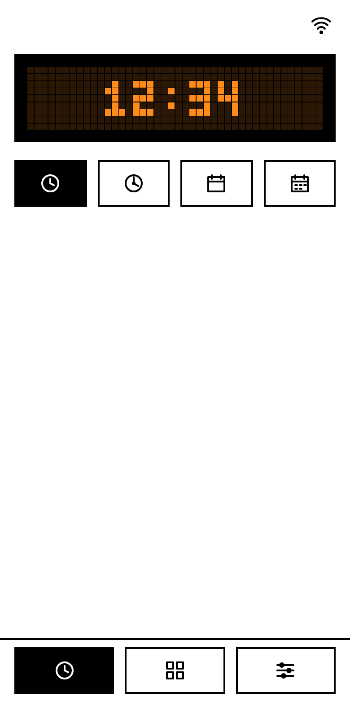
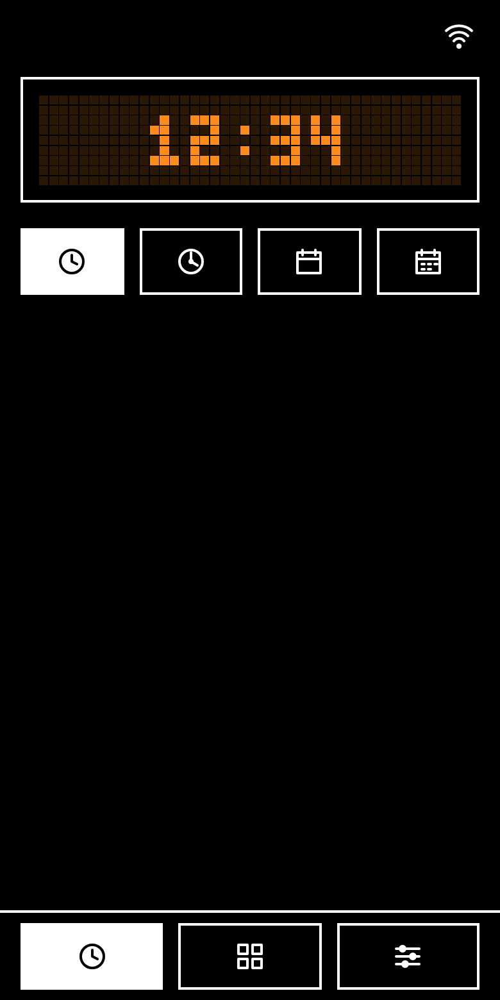
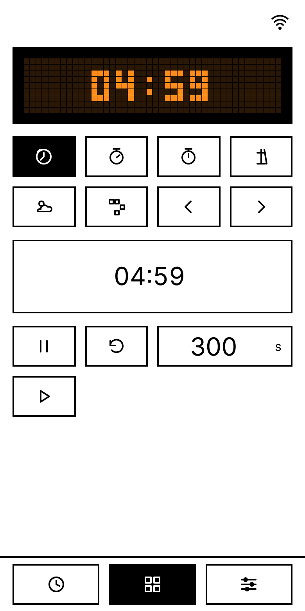
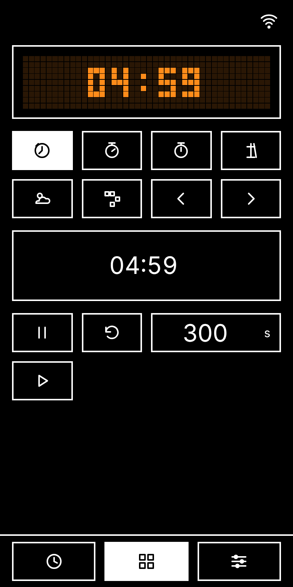
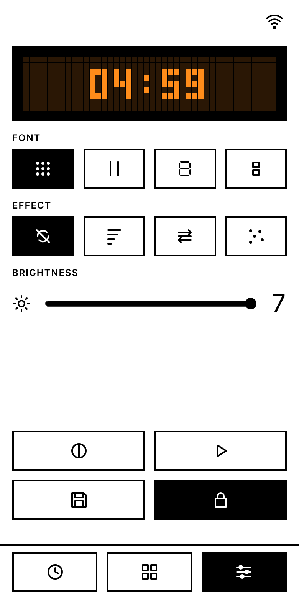
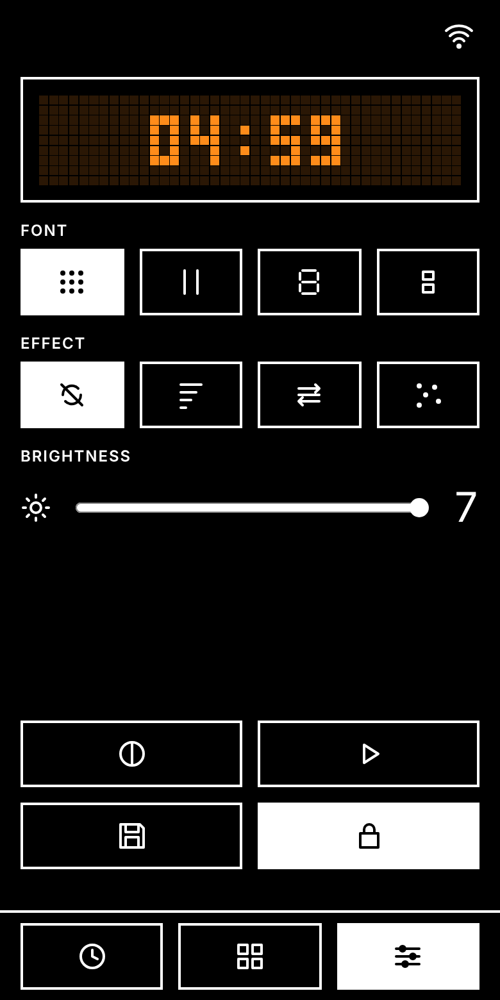

# User manual

## 1. First setup

1. Flash a release binary (see the README).
2. Connect over USB serial (115200 baud) and send, one line each:
   - `wifi <SSID><TAB><password>`
   - `ota <password>` (12–64 characters; reboot afterwards)
3. The clock syncs time over NTP (timezone JST) and serves the web UI at `http://kortlinje-c3.local/` or its IP address (shown by `status`).

Other serial commands: `status`, `wifi-scan`, `buttons`, `reboot`, `font <name>`, `effect <name>`, `brightness <0-7>`, `preview`, and mode names (`clock`, `date`, `life`, `snow`, `rain`, `dither`, `snake`, `pong`, `calibrate`). `wifi-scan` reports whether the configured SSID is visible, with channel and signal strength, without printing the SSID or password. A disconnect reason is printed while Wi-Fi is failing.

## 2. Web UI

The UI follows the system light/dark setting. The top bar shows the Wi-Fi/connection state. The black panel mirrors the 42×9 display. Three tabs at the bottom switch pages.

### Clock tab

 

Select the display: clock, seconds, date, calendar.

### Apps tab

 

Two pages, switched with the arrow buttons: countdown, Pomodoro, stopwatch, tempo, sky, life, snow, rain, dither, snake, pong, and button calibration. Controls for the selected app appear below (start/pause, reset, lap, tap, direction keys). Countdown length is set in seconds (10–5999) with the number field and the play button next to it.

### Settings tab

 

- **Font**: pixel, thin, segment, tiny5.
- **Effect**: transition between minutes: off, wipe, roll, dissolve.
- **Brightness**: 0–7.
- Buttons: invert pixels, preview the selected font/effect, save, and lock state.
- **Keys**: use TOP and BACK to assign each of the eight physical buttons a display or app mode. `DEFAULT` keeps the existing action for the current app. The last decoded button and ADC voltage appear beneath the assignments. `CALIBRATE` shows the next pressed button's name on the clock; use `EXIT` in the web UI or hold the physical MODE button to leave.
- **Weather**: save latitude and longitude for a future forecast integration. This version does not fetch or display forecast data.

## 3. Unlocking changes

Changes from the web UI are accepted only while unlocked. Unlock at the device by pressing the `set` key on the rear button ladder; the lock icon turns on and stays unlocked for 60 seconds. Use the serial `buttons` command to see which physical key reports as `set`.

## 4. Physical buttons

The two button ladders report different keys by voltage: rear (`set`, `alarm`, `up`, `down`) and top (`snooze`, `bell`, `brightness`, `mode`).

- `set`: unlock the web UI
- `up` / `down`: previous / next font
- `snooze`, `brightness`, `mode`, `bell`, `alarm`: act on the current app (for example direction keys in snake, tap in tempo, start/pause in Pomodoro). On the clock they change mode and brightness; `alarm` enters calibration.
- A saved key assignment changes that key to a global mode shortcut. It takes priority over the app's default action. `set` still unlocks the web UI before its assigned shortcut runs. Holding MODE still returns to the clock.

## 5. Updating

OTA uses the `ota` password. After an OTA update the new image is confirmed only after Wi-Fi, OTA, HTTP and MQTT (if enabled) work on the trial boot; otherwise it rolls back.

## 6. MQTT (optional)

Set `MQTT_URI`, credentials, and `MQTT_TOPIC_PREFIX` in `MqttPrivate.h` and build from source. Topics under the prefix: `text`, `mode`, `font`, `effect`, `preview` (subscribed), `status`, `event` (published).
